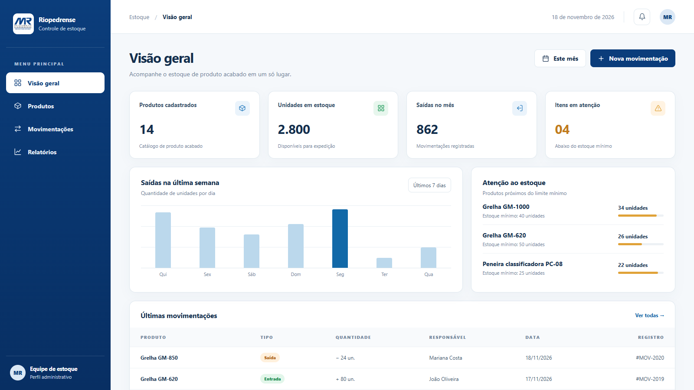
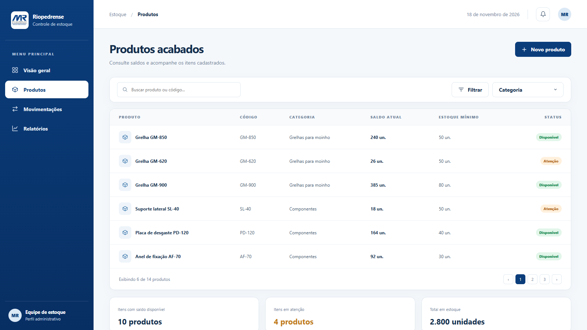
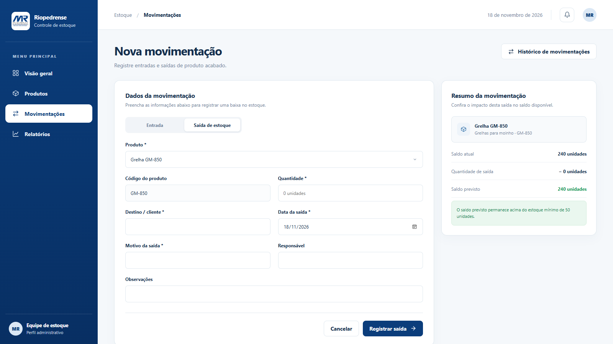
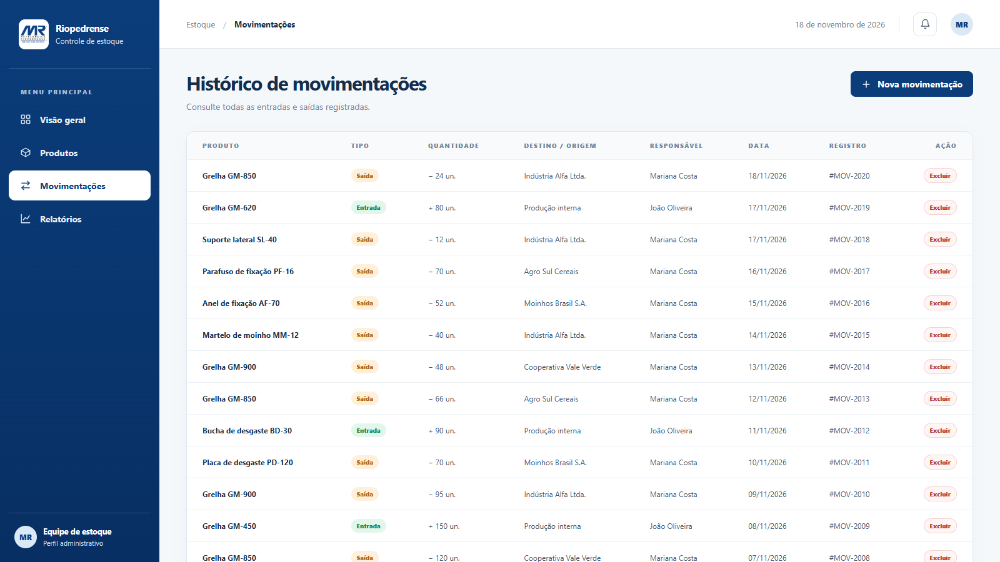
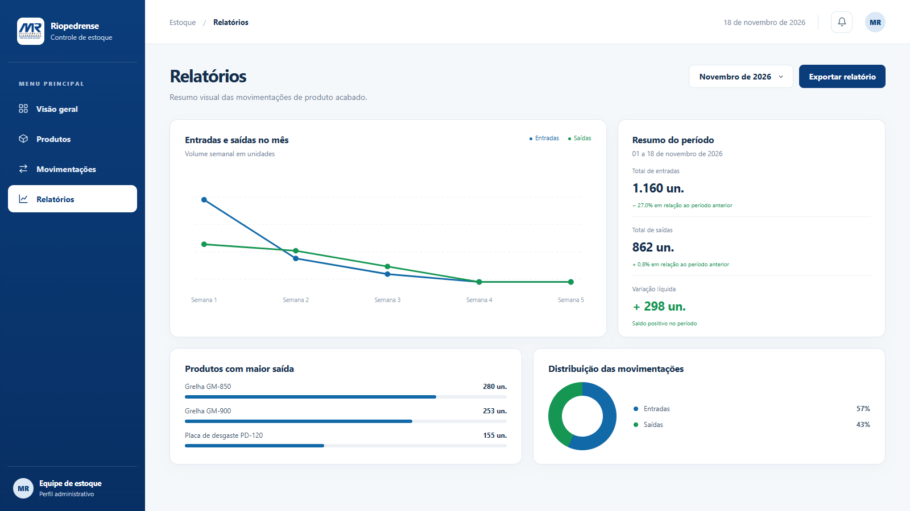

# Controle de Estoque — Metalúrgica Riopedrense

Sistema web de controle de estoque de **produto acabado** desenvolvido para a Metalúrgica Riopedrense (fabricante de grelhas para moinho), como projeto do **PIC I — Projeto Integrador** do curso de Ciência da Computação.
                                                                                                               
## Objetivo

Substituir controles manuais por um sistema simples, onde a equipe de estoque consegue:  

- cadastrar e consultar os produtos acabados e seus saldos;
- registrar entradas e saídas de estoque, com atualização automática do saldo;
- identificar rapidamente os itens abaixo do estoque mínimo;
- acompanhar relatórios mensais de movimentação e exportá-los em planilha.
  

## Integrantes

| Nome | RA |
| --- | --- |
| Gabriel Vergílio Passarini | 202610123 |
| Flávio Alex Chiarion Júnior | 202610078 |
| Guilherme Nogueira Tavares Ramalho | 202610157 |
| Raul Ulrich Matarazo | 202610081 |

## Tecnologias utilizadas

- **HTML5** — estrutura das telas
- **CSS3** — estilização (layout com Flexbox e Grid)
- **JavaScript** — interação das telas e comunicação com o backend (`fetch`)
- **PHP 8** — backend (login, sessão e CRUD)
- **MySQL / MariaDB** — banco de dados

## Estrutura do projeto

```
riopedrense-estoque/
├── index.html              redireciona para a tela de login
├── frontend/
│   ├── index.html          login
│   ├── painel.html         visão geral
│   ├── produtos.html       CRUD de produtos
│   ├── movimentacao.html   nova entrada / saída
│   ├── historico.html      histórico de movimentações
│   ├── relatorios.html     relatórios mensais
│   ├── css/style.css
│   ├── js/                 um arquivo JS por tela + comum.js
│   └── img/                logo e favicon
├── backend/
│   ├── conexao.php         conexão com o banco e funções auxiliares
│   ├── verificar.php       bloqueia acesso sem login
│   ├── login.php / sair.php / sessao.php
│   ├── produtos_listar.php / produto_salvar.php / produto_excluir.php
│   ├── movimentacoes_listar.php / movimentacao_salvar.php / movimentacao_excluir.php
│   ├── painel.php / relatorio.php / exportar.php
├── sql/
│   └── banco.sql           criação do banco, tabelas e dados de exemplo
└── docs/prints/            imagens das telas
```

## Requisitos

- [XAMPP](https://www.apachefriends.org/) (Apache + PHP 8 + MariaDB), ou outro ambiente com PHP 8 e MySQL/MariaDB
- Extensão `mysqli` do PHP habilitada (já vem ativa no XAMPP)
- Navegador atualizado (Chrome, Edge ou Firefox)

## Instalação e execução

1. Instale o XAMPP e inicie os módulos **Apache** e **MySQL** no painel de controle.
2. Copie a pasta `riopedrense-estoque` para `C:\xampp\htdocs\`.
3. Crie o banco de dados importando o arquivo `sql/banco.sql`:
   - pelo **phpMyAdmin** (`http://localhost/phpmyadmin` → aba *Importar* → selecionar `banco.sql` → *Executar*); ou
   - pelo terminal:
     ```
     C:\xampp\mysql\bin\mysql.exe -u root < C:\xampp\htdocs\riopedrense-estoque\sql\banco.sql
     ```
4. Acesse no navegador: `http://localhost/riopedrense-estoque/`
5. Entre com o usuário de demonstração:
   - **E-mail:** `admin@riopedrense.com.br`
   - **Senha:** `123456`

### Configuração

Os dados de acesso ao banco ficam em `backend/conexao.php`. O padrão do XAMPP é usuário `root` sem senha:

```php
$conexao = mysqli_connect("localhost", "root", "", "riopedrense_estoque");
```

Se o seu MySQL usar outra senha ou porta, altere essa linha.

## Principais funcionalidades

- **Login** com sessão PHP e senha criptografada (`password_hash`).
- **Visão geral:** total de produtos, unidades em estoque, saídas do mês, itens em atenção, gráfico de saídas dos últimos 7 dias, alertas de estoque mínimo e últimas movimentações.
- **Produtos (CRUD completo):**
  - cadastrar (botão *Novo produto*);
  - listar com busca por nome/código, filtro por categoria, filtro de itens em atenção e paginação;
  - editar e excluir (clicando na linha do produto).
- **Movimentações:**
  - registrar entrada ou saída, com resumo do saldo previsto em tempo real;
  - bloqueia saída maior que o saldo disponível;
  - histórico completo com opção de excluir (o saldo do produto é corrigido automaticamente).
- **Relatórios:** entradas e saídas por semana, comparação com o mês anterior, produtos com maior saída, distribuição entre entradas e saídas e **exportação em CSV** (abre no Excel).
- **Sair:** clique no avatar "MR" no topo ou no perfil no rodapé do menu.

## Banco de dados

| Tabela | Descrição |
| --- | --- |
| `usuarios` | usuários com acesso ao sistema |
| `produtos` | catálogo de produtos acabados, saldo atual e estoque mínimo |
| `movimentacoes` | entradas e saídas, ligadas ao produto por chave estrangeira |

## Telas

### Login


### Visão geral


### Produtos


### Nova movimentação


### Histórico de movimentações


### Relatórios



